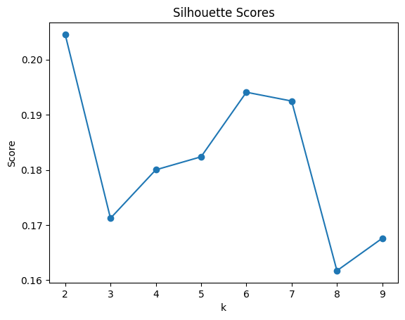
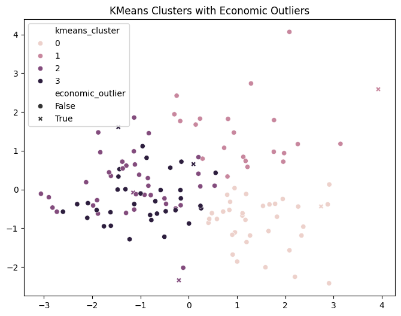

# African Farm-Led Irrigation: Household Segmentation

**Development analytics | Unsupervised learning | Python**

## Research question

**Why it matters:** Development organizations have limited resources and need to understand heterogeneous household needs rather than assume all farming households face the same constraints.

**Business question:** Can household resource and food-security indicators reveal meaningful segments and unusual households for further investigation and targeted support?

## Data and methodology

Academic team project using 131 SAFI household survey records (14 original columns). Seven numeric clustering features describe household size, livestock, rooms, meals, months of food shortage, years of residence and items owned. The notebook engineers features, scales numeric variables, compares mixed-type Gower distances and applies K-means, Ward hierarchical clustering, PCA, UMAP and Isolation Forest.

## Key findings

The highest silhouette score occurred at k=2; the team selected k=4 for a more granular, interpretable segmentation near the elbow. Isolation Forest flagged 13 households as anomalous using a 10% contamination setting.

## Business implications and limitations

The segments can guide follow-up interviews and exploration of resource or food-security needs. Anomaly flags are not proof of vulnerability, and cluster assignments depend on feature scaling and modeling choices. The small observational sample does not establish the causal effects of irrigation membership.

## Explore the analysis

[Project notebook](notebooks/farm-irrigation-analysis.ipynb) · pandas, scikit-learn, SciPy, UMAP, Matplotlib, Seaborn.
